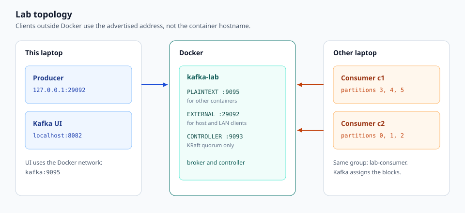
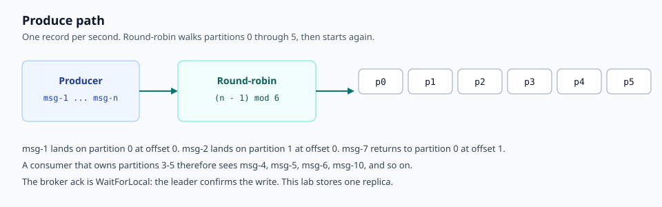
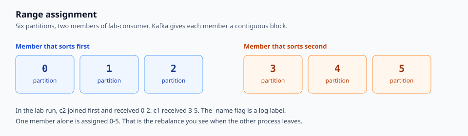

# Kafka lab

A single-broker KRaft broker, a four-broker cluster, and a Go producer and consumer built with [IBM Sarama](https://github.com/IBM/sarama). The lab is for learning listeners, advertised addresses, and how a consumer group splits partitions.

The deep reference is [explanation.md](explanation.md). Start here to run it.

## Layout

| Path | Role |
| --- | --- |
| `docker-compose.yml` | One combined broker and Kafka UI |
| `docker-compose.cluster.yml` | Four combined brokers and Kafka UI |
| `.env` | LAN address advertised to clients outside Docker |
| `producer/` | Writes one record per second, round-robin across 6 partitions |
| `consumer/` | Joins `lab-consumer` and logs the partitions it was given |
| `topic/` | Creates `lab-events` with 6 partitions |
| `constants/` | Broker addresses, topic name, group id, partition count |
| `docs/images/` | Topology, produce path, and assignment diagrams |

## Prerequisites

- Docker Desktop
- Go 1.26 or newer. Sarama v1.61 requires it. `go run` downloads that toolchain when the installed Go is older.

Do not start both Compose files together. Both publish host port `29092`.

## Single broker

From the repository root:

```bash
docker compose up -d
```

| Surface | Address |
| --- | --- |
| Host and LAN clients | `<LAN address>:29092` |
| Producer on this machine | `127.0.0.1:29092` |
| Kafka UI, from other containers | `kafka:9095` |
| Kafka UI in a browser | http://localhost:8082 |

`KAFKA_ADVERTISED_HOST` in `.env` must be this machine's LAN address, and it must match `constants.RemoteBootstrapServer`. Clients on another computer use that address after the first metadata response. `host.docker.internal` only resolves on this machine.



## Produce and consume

On this laptop:

```bash
go run ./producer
```

```bash
go run ./consumer -name c1 -brokers 127.0.0.1:29092
```

On a second terminal, or on another laptop that can reach the LAN address:

```bash
go run ./consumer -name c2 -brokers 127.0.0.1:29092
```

`-name` is required. It is only a label in the log. Both processes use the group `lab-consumer`, so Kafka splits `lab-events` between them.





A member that is alone in the group is assigned all six partitions. When the second member joins, the group rebalances and each member keeps a block of three. The log line `assigned partitions` is the assignment Kafka just made.

## Another computer on the same network

1. Set `KAFKA_ADVERTISED_HOST` in `.env` to this laptop's LAN address.
2. Set `constants.RemoteBootstrapServer` to that same address with port `29092`.
3. Recreate the broker so the new advertised listener is loaded: `docker compose up -d --force-recreate kafka`.
4. From the other computer, `ping` that address. `Destination host unreachable` means the two machines are not on the same L2 network. Kafka is not involved yet.
5. Run the consumer with no broker flag. The default is `RemoteBootstrapServer`.

```bash
go run ./consumer -name c1
```

## Four-broker cluster

```bash
docker compose -f docker-compose.cluster.yml up
```

| Broker | Host port | Docker address |
| --- | --- | --- |
| kafka-1 | 29092 | kafka-1:19092 |
| kafka-2 | 39092 | kafka-2:19092 |
| kafka-3 | 49092 | kafka-3:19092 |
| kafka-4 | 59092 | kafka-4:19092 |

Kafka UI for the cluster is http://localhost:8083.

The cluster file advertises `host.docker.internal`. That is reachable from this laptop, not from another machine. Internal topics use replication factor 3 and minimum in-sync replicas 2. All four nodes are combined broker-controllers, so the controller quorum needs three voters up. A production cluster uses an odd controller count, usually 3 or 5.