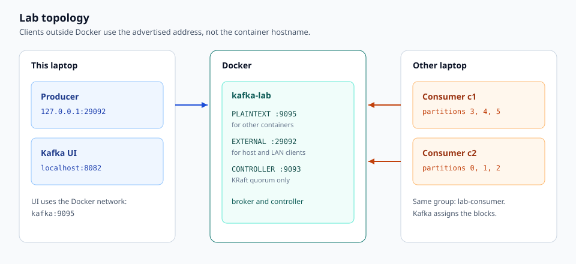
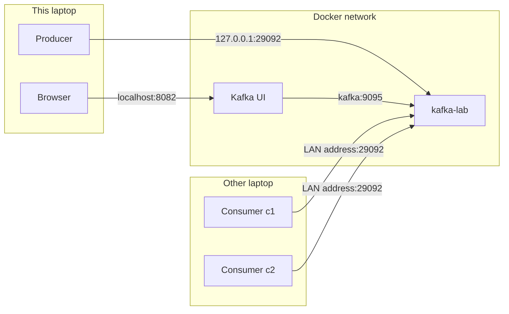
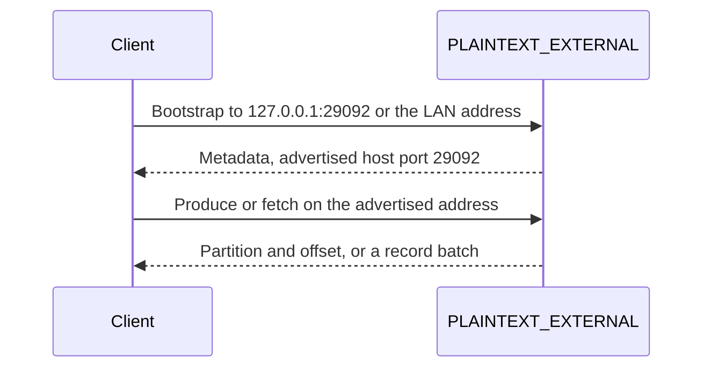
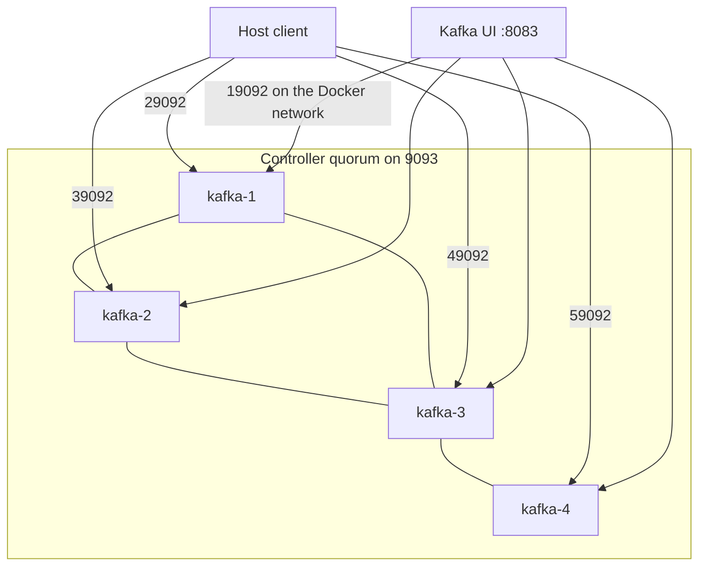
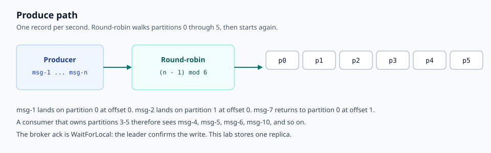
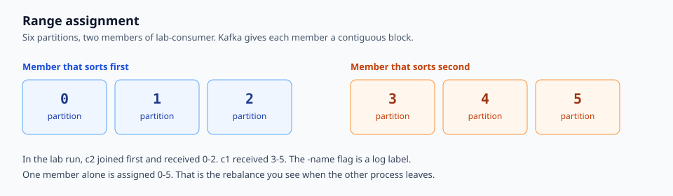
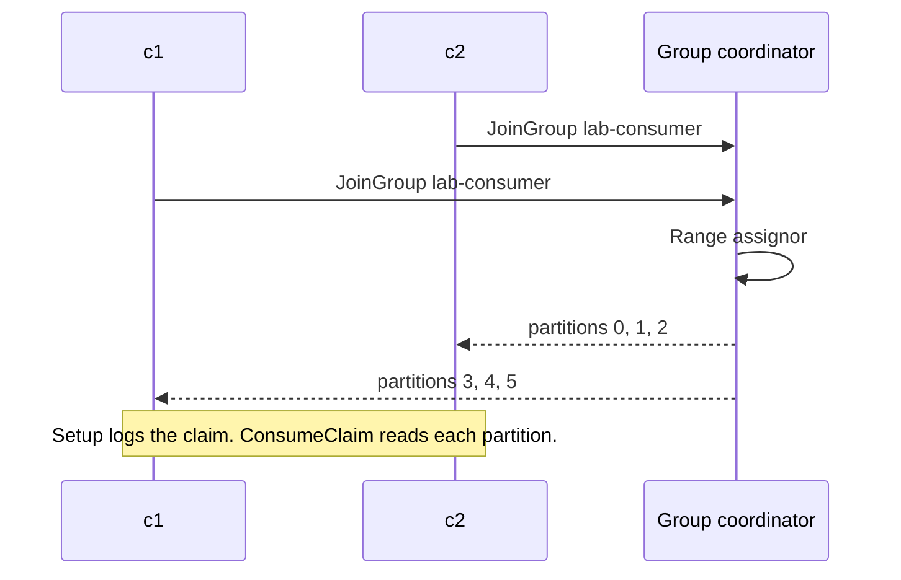
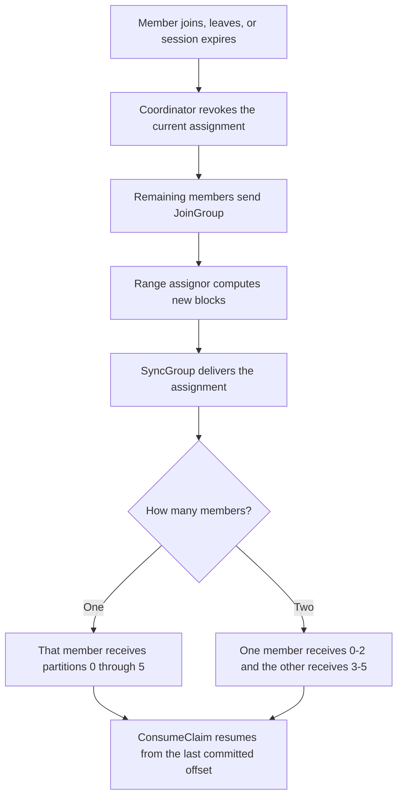
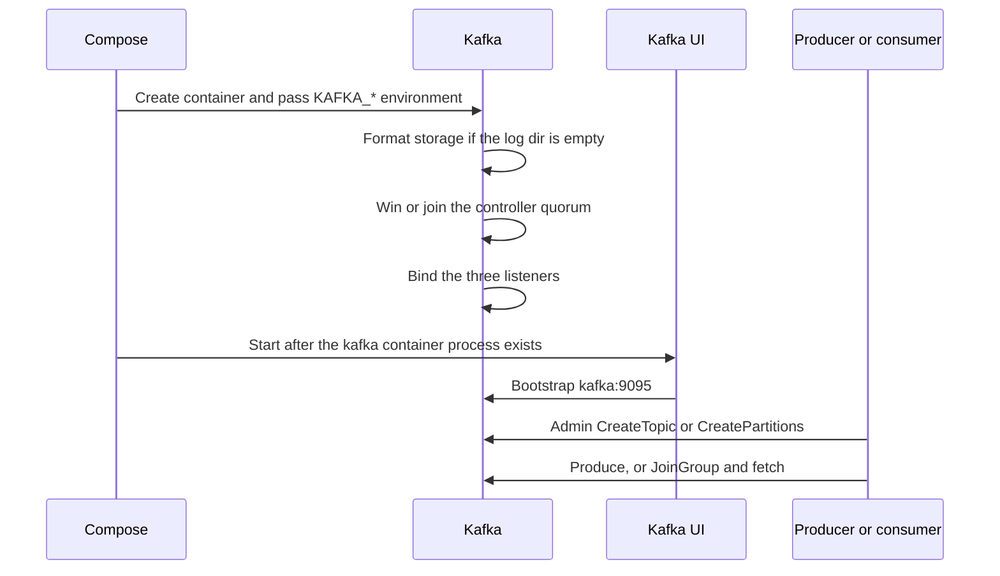

# Kafka lab reference

This is the reference for the Compose files and the Sarama clients in this repository. [README.md](README.md) is the runbook. The diagrams live in [docs/images](docs/images).

## 1. Topology

One Docker Compose project runs a KRaft node that is both broker and controller, plus Kafka UI. A second Compose file runs four such nodes. The Go producer and consumer run on the host, or on another machine on the LAN.





Three audiences reach the broker, and each audience has its own listener:

| Audience | Listener | Address it can open |
| --- | --- | --- |
| Containers on the Compose network | `PLAINTEXT` | `kafka:9095` |
| Processes on this laptop, and other LAN machines | `PLAINTEXT_EXTERNAL` | `<advertised host>:29092` |
| The KRaft controller quorum | `CONTROLLER` | `kafka:9093` |

## 2. Why advertised listeners exist

`listeners` is the socket the process binds. `advertised.listeners` is the address returned in metadata. After the bootstrap connection, the client drops that first address and reconnects to whatever the broker advertised for the listener that accepted the connection.



`host.docker.internal` resolves on this laptop. A consumer on another laptop receives that name in metadata and cannot resolve it, so the fetch times out even when the first TCP connection succeeded. The single-node file therefore advertises `KAFKA_ADVERTISED_HOST` from `.env`.

That value and `constants.RemoteBootstrapServer` are the same endpoint. Change both, then recreate the broker:

```bash
docker compose up -d --force-recreate kafka
```

The producer on this laptop bootstraps at `127.0.0.1:29092` because `localhost` can resolve to IPv6, and Docker Desktop does not accept that connection. Metadata then points the producer at the LAN address, which is also published on the host.

## 3. KRaft

This stack has no ZooKeeper. Each Kafka process sets `process.roles`.

| Value | Meaning in this lab |
| --- | --- |
| `broker` | Serves producers and consumers |
| `controller` | Votes in the metadata quorum |
| `broker,controller` | Combined mode. Every node in both Compose files uses this. |

Combined mode is the right shape for a lab. A production deployment usually runs controllers as a separate process so a broker failure does not also remove a quorum vote.

`node.id` is unique inside the cluster. The single node is `1`. The four-broker file uses `1` through `4`.

`controller.quorum.voters` lists every controller as `id@host:port`. The single node is `1@kafka:9093`. The cluster is `1@kafka-1:9093,2@kafka-2:9093,3@kafka-3:9093,4@kafka-4:9093`. A vote commits when a majority agrees. Four voters need three nodes up, so the cluster tolerates one controller failure. Production quorums use 3 or 5 voters.

`controller.listener.names=CONTROLLER` tells the process which listener name is the Raft listener. That name must appear in `listeners` and in `listener.security.protocol.map`.

Every node in one cluster formats storage with the same cluster id. The four-broker file sets `CLUSTER_ID` explicitly. The single-node file lets the image generate one, which is safe only because there is one process.

## 4. Single-node configuration

Service `kafka`, container `kafka-lab`, image `apache/kafka:latest`.

### Ports

| Publish | Container port | What it reaches |
| --- | --- | --- |
| `29092:29092` | `PLAINTEXT_EXTERNAL` | Host and LAN clients |
| `9095:9092` | container port 9092 | Nothing in this broker. `PLAINTEXT` listens on 9095, which other containers reach as `kafka:9095` on the Docker network. The published mapping is unused. |

Use `29092` from any process that is not attached to the Compose network.

### Environment

Docker turns each `KAFKA_*` variable into the matching broker property (`KAFKA_NODE_ID` becomes `node.id`).

| Variable | Value | Why it is set |
| --- | --- | --- |
| `KAFKA_NODE_ID` | `1` | Identity of this process in the quorum and in the cluster |
| `KAFKA_PROCESS_ROLES` | `broker,controller` | Combined KRaft node |
| `KAFKA_CONTROLLER_QUORUM_VOTERS` | `1@kafka:9093` | The only voter |
| `KAFKA_LISTENERS` | `PLAINTEXT://0.0.0.0:9095`, `PLAINTEXT_EXTERNAL://0.0.0.0:29092`, `CONTROLLER://0.0.0.0:9093` | Sockets to bind. `0.0.0.0` accepts every interface inside the container |
| `KAFKA_ADVERTISED_LISTENERS` | `PLAINTEXT://kafka:9095`, `PLAINTEXT_EXTERNAL://${KAFKA_ADVERTISED_HOST}:29092` | Addresses clients are told to use |
| `KAFKA_LISTENER_SECURITY_PROTOCOL_MAP` | each name maps to `PLAINTEXT` | Names the listeners. There is no TLS |
| `KAFKA_INTER_BROKER_LISTENER_NAME` | `PLAINTEXT` | Replication traffic, if a second broker existed, would use the Docker-network listener |
| `KAFKA_CONTROLLER_LISTENER_NAMES` | `CONTROLLER` | Raft traffic stays off the client listeners |
| `KAFKA_OFFSETS_TOPIC_REPLICATION_FACTOR` | `1` | The `__consumer_offsets` topic cannot ask for more replicas than there are brokers |
| `KAFKA_TRANSACTION_STATE_LOG_REPLICATION_FACTOR` | `1` | Same constraint for the transaction log |
| `KAFKA_TRANSACTION_STATE_LOG_MIN_ISR` | `1` | A produce with `acks=all` can succeed with the single replica |
| `KAFKA_LOG_DIRS` | `/tmp/kraft-combined-logs` | Log segments and KRaft metadata. Not a mounted volume |

`PLAINTEXT` in the protocol map means the bytes are not encrypted and the client is not authenticated. It is not the same word as the listener name `PLAINTEXT`, though this file uses that name for the internal listener.

### Kafka UI

| Setting | Value |
| --- | --- |
| Image | `provectuslabs/kafka-ui:latest` |
| Container | `kafka-ui` |
| Publish | `8082:8080` |
| Bootstrap | `kafka:9095` |
| `depends_on` | Starts after the `kafka` container has started, not after it is ready to accept clients |

## 5. Four-broker cluster

`docker-compose.cluster.yml` runs `kafka-1` through `kafka-4`. Each container binds the same ports inside its own network namespace. Host ports are unique.



Shared settings come from the `x-kafka-common` anchor. Each service overrides `KAFKA_NODE_ID` and `KAFKA_ADVERTISED_LISTENERS`.

| Concern | Single node | Four brokers |
| --- | --- | --- |
| Inter-broker listener | `kafka:9095` | `kafka-N:19092` |
| External listener inside the container | `29092` | `9092`, published as `29092`, `39092`, `49092`, `59092` |
| Advertised external host | LAN address from `.env` | `host.docker.internal` |
| Offsets topic replication | 1 | 3 |
| Transaction log min ISR | 1 | 2 |
| Default partitions for auto-created topics | broker default | 4 |
| `lab-events`, created by the Go admin client | 6 partitions, replication factor 1 | still 1, unless you change `constants.TopicReplicationFactor` |
| Cluster id | generated | `KafkaLab4BrokerClstr1` on every node |

Replication factor 3 with minimum in-sync replicas 2 means a topic write with `acks=all` succeeds while any three brokers hold the record, and still succeeds after one broker is gone. It fails when two brokers are gone.

The Go clients still create `lab-events` with replication factor 1, because that constant matches the single-broker lab. Point them at the cluster only after raising that constant, or the topic is under-replicated relative to the cluster's own internal topics.

## 6. Producer

`producer/main.go` ensures the topic, then sends one record per second until interrupted.



| Choice | Value | Effect |
| --- | --- | --- |
| Client | Sarama `SyncProducer` | `SendMessage` blocks until the ack |
| Acks | `WaitForLocal` | The leader has the record. Same as `acks=1` |
| Partitioner | `NewRoundRobinPartitioner` | Successive records move to the next partition. The key is not hashed |
| Key | `msg-N` | Present so the log shows which record went where. It does not select the partition |
| Topic | `lab-events` | `constants.DefaultTopic` |
| Partitions | 6 | `constants.TopicPartitionCount` |
| Replication factor | 1 | `constants.TopicReplicationFactor` |
| Bootstrap | `127.0.0.1:29092` | `constants.LocalBootstrapServer` |

Partition and offset in the producer log are the values the broker returned:

```text
sent partition=0 offset=0 key=msg-1
sent partition=1 offset=0 key=msg-2
sent partition=5 offset=0 key=msg-6
sent partition=0 offset=1 key=msg-7
```

`topic.EnsurePartitions` calls Sarama's cluster admin. `CreateTopic` is enough when the topic is new. When it already exists, `CreatePartitions` raises the count to 6. `ErrInvalidPartitions` means the topic already has at least that many partitions, and the call is treated as success. Kafka will not shrink a topic.

## 7. Consumer group

`consumer/main.go` joins `constants.ConsumerGroupID` (`lab-consumer`). The `-name` flag is required and is printed on every line. Kafka never reads it.

The balance strategy is range:

```go
saramaConfig.Consumer.Group.Rebalance.GroupStrategies = []sarama.BalanceStrategy{
    sarama.NewBalanceStrategyRange(),
}
```

The group coordinator runs that assignor. The application does not pick partition numbers. Range sorts partitions and sorts members, then deals contiguous blocks. Two members and six partitions produce the blocks in the diagram.



`Setup` runs after each assignment and logs `assigned partitions`. `ConsumeClaim` runs once per assigned partition, concurrently. That is why a single consumer's log mixes partition 3, 4, and 5 while each partition's offsets stay ordered.

`Offsets.Initial` is `OffsetOldest`, so a group with no committed offset reads from the start of each partition. `MarkMessage` records progress. Sarama commits those marks on its auto-commit interval.



### Rebalance

A rebalance starts when a member joins, leaves, or misses heartbeats long enough for the session to expire.



The lab run showed both shapes. While `c1` and `c2` were both in the group, the claims were `[3 4 5]` and `[0 1 2]`. When one process dropped, the survivor logged `[0 1 2 3 4 5]`. When the second process returned, the blocks split again.

Records such as `msg-142` showed up in both processes. The new owner started at the last committed offset, and the previous owner had already logged a record whose commit had not landed. The topic was not duplicated. The read was.

## 8. Startup order



`depends_on` does not wait for the quorum. If a client starts in the same second as the container, the first dial can fail. Run the client again once the broker log says the server has started.

## 9. Durability and security boundary

Log segments are inside the container at `/tmp/kraft-combined-logs`. `docker compose down`, a recreate, or a new container drops them. There is no volume, no TLS, and no SASL. Anyone who can open port `29092` can produce and consume.

The macOS application firewall was off during the lab. A ping failure of `Destination host unreachable` is still a routing or Wi-Fi isolation problem: the packet never arrived at this laptop. Confirm the other machine has an address in `192.168.1.0/24` when this laptop is `192.168.1.8`, and that both are on the same SSID. Guest networks and AP isolation drop client-to-client traffic even when both machines can reach the internet.

The Windows log clock in the sample run was about a minute behind the timestamps inside the records. Those timestamps are written by the producer. Line them up by the record body, not by the log prefix.

## 10. Configuration index

| You want to change | Edit |
| --- | --- |
| LAN address clients are told to use | `.env` `KAFKA_ADVERTISED_HOST` and `constants.RemoteBootstrapServer`, then recreate `kafka` |
| Topic name | `constants.DefaultTopic` |
| Partition count | `constants.TopicPartitionCount` |
| Replica count of `lab-events` | `constants.TopicReplicationFactor` |
| Consumer group | `constants.ConsumerGroupID`, or `-group` |
| Which process a log line came from | `-name` on the consumer |
| Broker a client dials first | `-brokers` |
